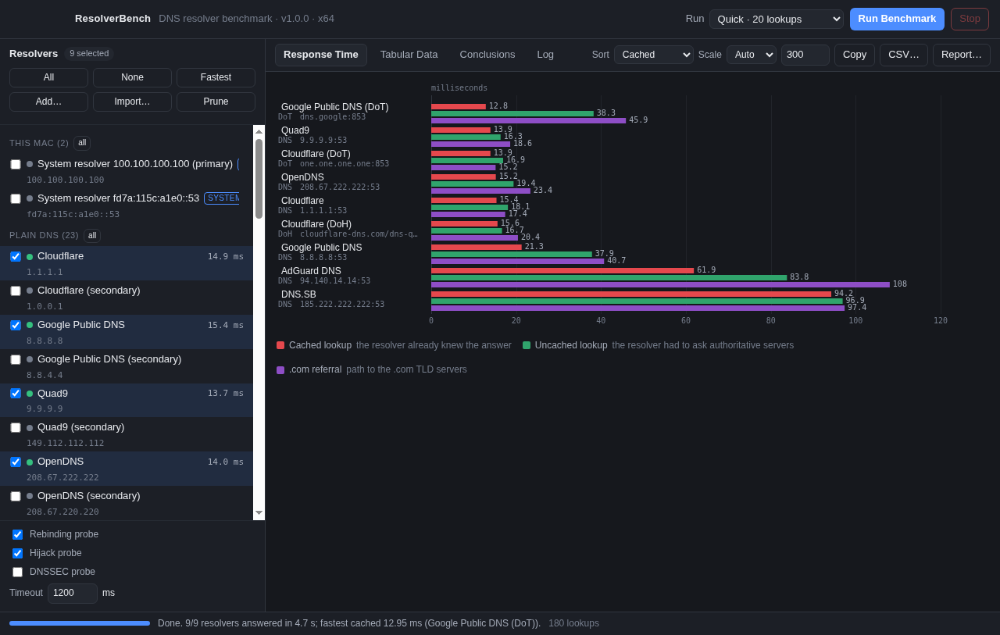
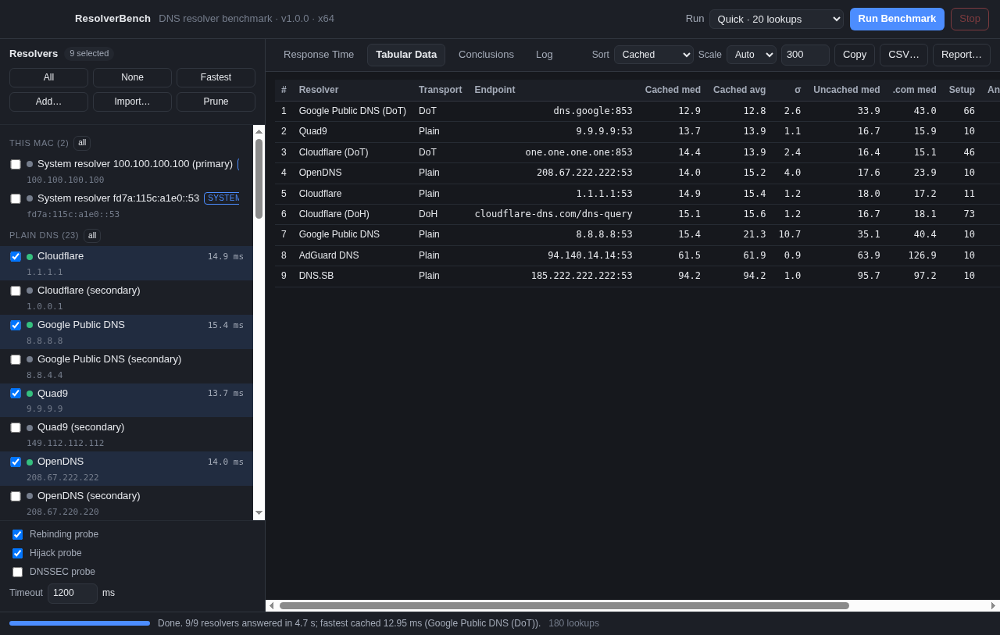
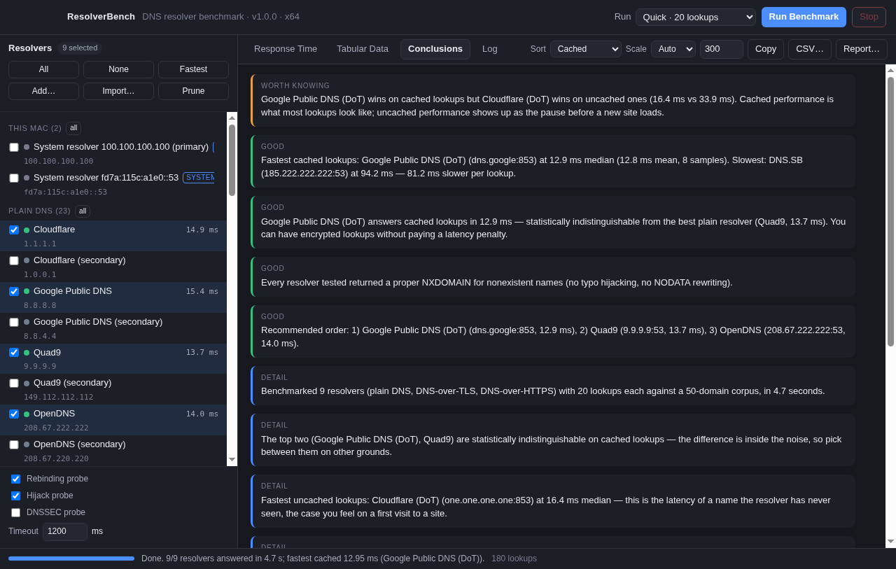

# ResolverBench

A macOS benchmark for DNS resolvers — plain DNS, **DNS-over-HTTPS** and **DNS-over-TLS**
measured side by side, the way GRC's classic DNS Benchmark measured plain ones.

ResolverBench answers the question *"which resolver should this Mac actually use?"* with
numbers taken from where you are: it queries each resolver directly (never through the
system resolver), separates the latencies that mean different things, checks reliability
and behaviour, and then writes the conclusion in English instead of leaving you staring at
a bar chart.



<details>
<summary>More screenshots</summary>





</details>

## What makes it different from other DNS benchmarks

**It benchmarks encrypted transports as first-class citizens.** Most DNS benchmarks only
speak UDP/53. This one measures the same resolver across all three transports, so the
question "does DoH or DoT cost me latency?" gets an answer: in-session queries are
comparable, the difference is the connection setup, and both numbers are reported.

**It separates cached from uncached from the `.com` referral leg.**

| Metric | What it measures | Why it matters |
| --- | --- | --- |
| **Cached** | A name the resolver already holds in its cache | ~all of your lookups look like this |
| **Uncached** | A name it has never seen, so it must ask the authoritative servers | the pause before a site you have never visited loads |
| **.com referral** | The path to the `.com` TLD servers, which every brand-new `.com` name needs first | separates a slow cache from a slow path off the resolver |

**It characterises behaviour, not just speed.** Every resolver is asked for a name that
cannot exist (typo hijacking / NXDOMAIN rewriting), for names that resolve to private IP
addresses (DNS rebinding protection), and optionally for DNSSEC-signed zones with the DO
bit set (does it validate?).

**It tells you when a difference is real.** Every comparison is a Welch t-test over the raw
samples at a 95% confidence level, so "12.4 ms vs 12.9 ms" is reported as a tie rather than
a ranking.

## Install

Download the latest `ResolverBench-<version>-arm64.dmg` (Apple silicon) from
[Releases](../../releases), open it, and drag the app to Applications.

The build is **ad-hoc signed, not notarized** — there is no paid Apple Developer ID behind
this project. macOS will therefore refuse the first launch with a "cannot be opened because
the developer cannot be verified" message. To open it anyway:

- **Right-click (or Control-click) the app → Open → Open**, once. macOS remembers the choice
  for that copy; or
- `xattr -dr com.apple.quarantine /Applications/ResolverBench.app` in Terminal.

Verify what you downloaded against `SHA256SUMS.txt` in the same release:

```bash
shasum -a 256 -c SHA256SUMS.txt
```

The app is arm64-only (Apple silicon). It is built and tested on Apple silicon runners, and
nothing it does requires an installer, a daemon, or root.

## Using it

1. Pick resolvers on the left. Your Mac's currently configured resolvers are listed at the
   top and selected by default, with a public catalog below them grouped by transport.
   **Add…** takes `1.1.1.1`, `1.1.1.1:5353`, `tls://dns.example`, `tcp://dns.example` or
   `https://dns.example/dns-query` — one per line, and a nameserver list built for GRC's
   tool can be pasted in as-is.
2. Choose how much work to do: **Quick** (20 lookups per resolver), **Standard** (50 —
   the count GRC's documentation settles on for statistical significance), or **Thorough**
   (100).
3. Press **Run Benchmark** (⌘R). Results stream in live; **Stop** (⌘.) keeps everything
   measured so far.
4. Read the **Conclusions** tab, then **CSV…** (⌘S) for the full table.

Benchmarking over Wi-Fi while something else is using the connection will change the
numbers. GRC's tool asks you to keep the network quiet, and that advice applies here too.

### Command line

The packaged app is also a command-line tool, which makes it usable from a scheduled job:

```bash
/Applications/ResolverBench.app/Contents/MacOS/ResolverBench --headless --quick \
  --servers cloudflare,google,quad9,cloudflare-dot,cloudflare-doh \
  --csv ~/dns-$(date +%F).csv --json ~/dns-$(date +%F).json

# everything in the catalog, full sampling, top 20 printed
/Applications/ResolverBench.app/Contents/MacOS/ResolverBench --headless --servers all --top 20

# a custom corpus, and only the resolvers this Mac is configured to use
/Applications/ResolverBench.app/Contents/MacOS/ResolverBench --headless --include-system --domains ./my-domains.txt
```

`--help` lists everything. Exit codes: `0` at least one resolver answered, `2` none did,
`3` bad usage, `4` interrupted (partial results are still written). From a source checkout,
`node src/engine/cli.js` is the same program.

## How the benchmark works

Each resolver gets its own transport client, and all resolvers run **in parallel and
interleaved** (one cached, one uncached and one `.com` question per round) so a resolver is
never measured alone with the network to itself or measured while a neighbour saturates it.

1. **Connect** — open the transport. A DoT resolver pays its TCP+TLS handshake here; that
   cost is reported as *setup* rather than folded into query latency. For DoH the first
   request pays TCP+TLS+HTTP and its total time becomes the setup figure.
2. **Warm** — resolve every name that will later be used as a cached sample, once, untimed,
   so the cached column measures cache hits instead of measuring who was asked first.
3. **Time** — the sample plan, round-robin across resolvers.
4. **Probe** — the characterisation questions, once per resolver.

Timeouts count as *lost* replies rather than being discarded: reliability is one of the
things being measured, and a resolver that drops one query in ten is worse than one that is
2 ms slower. Requests are strictly serialised per resolver — two questions in flight on one
connection would otherwise each be inflated by the other's queueing delay.

`AS` for DoH the body is the wire format with `content-type: application/dns-message`
(RFC 8484), POST, over a keep-alive connection; the number of connections opened versus
requests made is recorded so a resolver that drops connections cannot masquerade as a fast
one. DoT uses RFC 7858 framing over one TLS session. Truncated UDP answers are retried over
TCP and flagged.

### Honest limitations

- **Your location decides the winner.** Anycast resolvers answer from the nearest point of
  presence, so someone else's results do not transfer. That is the point of measuring.
- **The `.com` figure is an approximation** of the referral leg: it uses fresh random
  `.com` labels, which measure the resolver's path to the TLD servers but may be served from
  a shallow negative cache.
- **The rebinding probe uses a public wildcard service** (`sslip.io`) that encodes a private
  address in the name. A resolver that hands the address back is not filtering private-range
  answers. A resolver that fails to resolve the probe at all is indistinguishable from one
  that filters it, which is why the results say how many ranges were filtered rather than
  claiming a verdict.
- **DNSSEC probing is off by default** because some resolvers misbehave when asked with the
  DO bit set; enable it deliberately.
- **DoH runs over HTTP/1.1 keep-alive**, not HTTP/2. Request latency over an established
  connection is what is being compared, and h1 keep-alive measures that without adding a
  protocol stack the results would then describe.
- **No notarization**, as above.
- The catalog is data, and data goes stale: anything that stops answering is reported as
  `dead` rather than being quietly dropped, and every catalog entry was verified by an
  actual query before release (see `docs/verification.md`).

## Development

```bash
npm install
node src/engine/cli.js --quick            # headless run from source
npm start                                  # the app
npm test                                   # unit + live-network integration tests
node scripts/make-ui-fixture.js --out=/tmp/fixture.json   # real results, for UI checks
node scripts/make-icon.js                  # regenerate build/icon.png
xvfb-run -a npx electron . --selftest-ui cloudflare,quad9 --screenshot=/tmp/shots   # headless UI checks
```

`npm test` includes tests that talk to the real internet (Cloudflare, Google and Quad9 over
UDP, DoT and DoH); set `RESOLVERBENCH_OFFLINE=1` to skip them.

Layout: `src/engine/` is pure Node with no Electron imports (wire codec, transports,
statistics, benchmark, conclusions, CSV, CLI); `src/main/` is the Electron main process and
the IPC surface; `src/preload/` is the entire API the window gets; `src/renderer/` is the
UI. The build workflow (`.github/workflows/build.yml`) runs the tests on Linux, then builds,
signs, smoke-tests and packages the arm64 app on an Apple silicon runner, and publishes the
DMG/ZIP when a `v*` tag is pushed.

## Credits and licence

Methodology is modelled on **GRC's DNS Benchmark** by Steve Gibson — the cached / uncached /
`.com` breakdown, the "conclusions" page, and the fifty-lookups-per-resolver sampling point
all come from its documentation. ResolverBench is an independent, unaffiliated
reimplementation for macOS and adds the encrypted transports; it contains no code from GRC's
program, and GRC's v1 binary (analysed during development, see
`docs/reverse-engineering-notes.md`) is not redistributed here.

MIT licensed. Nothing is sent anywhere: the app talks only to the resolvers you select.
